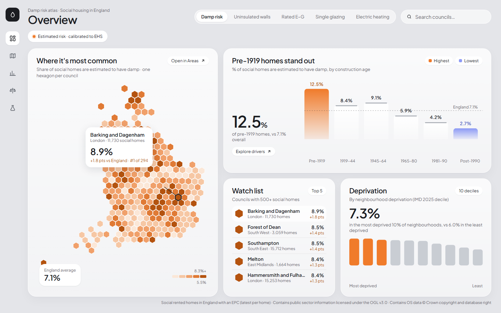
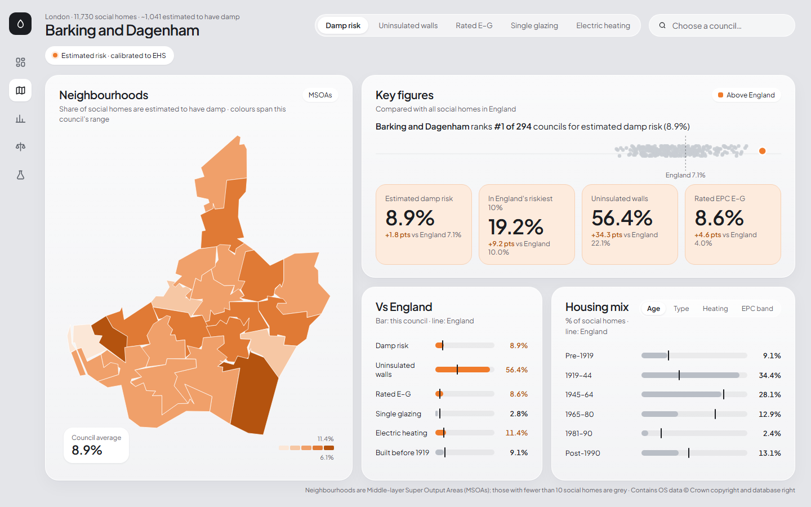

# Damp Risk Atlas: Predicting damp & mould risk in England's social housing

> **Status:** model built and live on the dashboard. Estimates come from building characteristics only (see limitations).

**Key findings:** an estimated **~203,000 social homes in England (7.1%) have damp**. Risk is driven most by **building age** (pre-1919 homes have 1.75× the odds of a typical home; post-1990 homes 0.45×) and **energy rating** (E–G: 2.2×). The highest-risk councils are **Barking and Dagenham (8.9%)**, Forest of Dean and Southampton; **74% of pre-1919 social homes have uninsulated walls**.

[📊 Live dashboard](https://bhobbs-0.github.io/damp-risk/) · [📄 Full write-up](reports/write-up.md) · [🧪 Notebooks](notebooks/)

[](https://bhobbs-0.github.io/damp-risk/)

<details>
<summary>Areas page: any council's neighbourhoods, ranking and housing mix</summary>

[](https://bhobbs-0.github.io/damp-risk/areas?council=E09000002)
</details>

---

## Why this matters

Damp and mould in social housing is a serious health risk. In 2020, two-year-old Awaab Ishak died from prolonged exposure to mould in his family's social rented home. **Awaab's Law** now requires social landlords in England to investigate and fix serious hazards within fixed deadlines.

Landlords mostly react to complaints. This project asks:

> **Which social homes in England are most at risk of damp and mould, and why?**

The aim is to support **proactive** inspection, so landlords can focus surveys and retrofit spending where risk is highest before tenants are harmed.

## Approach

Home-level survey microdata wasn't available (the UK Data Service declined access), so the model is **calibrated to the English Housing Survey's published, open damp rates**:

```
 EHS published damp rates (DA5101/DA5102)      EPC register
 social homes, by age / type / floor area        2.86m social homes, each with
 (+ energy rating from the EHS report)           age, type, floor area, rating
            │                                               │
            └──── logistic model calibrated so that, applied to the real
                  mix of EPC homes, it reproduces every published rate ────┐
                                                                            │
                     score every home → aggregate to neighbourhoods / councils
                                                                            │
          validate on breakdowns the model never saw (region, deprivation)  │
                                                   → dashboard ◀────────────┘
```

1. **Prepare** 2.86m EPC records: latest certificate per home, social rented, England; parse free-text fields into survey-style categories.
2. **Collect** published damp rates for social homes (average of 2023 and 2024).
3. **Calibrate** an additive logistic model so its predicted category rates match every published rate *simultaneously* on the real joint mix of homes. Because the EPC data shows how characteristics occur together, overlapping effects (old homes are often poorly rated) aren't double-counted, unlike multiplying risk ratios.
4. **Score** every home and **aggregate** to MSOA neighbourhoods and councils (area level only).
5. **Validate** by predicting breakdowns the model never saw, against a sampling-noise floor, and by leaving each fitted breakdown out.

## Data sources

| Dataset | Publisher | Use | Licence |
|---|---|---|---|
| English Housing Survey live tables DA5101, DA5102 (damp and mould) | MHCLG | Published damp rates: calibration and validation | Open Government Licence |
| Domestic Energy Performance Certificates | MHCLG | Homes to score | Open data |
| English Indices of Deprivation 2025 | MHCLG | Deprivation context and validation | Open Government Licence |
| LSOA 2021 boundaries; postcode lookup (May 2026) | ONS Open Geography Portal | Linking homes to areas; maps | Open Government Licence |

Raw data is **not included** in this repository. See [Getting the data](#getting-the-data) and [docs/data-sources.md](docs/data-sources.md).

## Results

| Check | Model error (pts) | Baseline (pts) | Notes |
|---|---|---|---|
| Fit to the 19 published rates | **0.2** | 1.7 | correlation 0.998 |
| Leave out building age | **1.8** | 2.6 | predicted from the other breakdowns |
| Leave out dwelling type | **0.45** | 1.08 | |
| Leave out floor area | **0.87** | 1.04 | |
| Leave out energy rating | **1.4** | 2.1 | |
| Deprivation decile (never seen) | 1.01 | 0.98 | at the sampling-noise floor (1.03) |
| Region (never seen) | 1.6 | 1.6 | above the noise floor (~1.0): regional differences beyond buildings |

Baseline = predicting the national rate for every category. Errors are averages in percentage points, weighted by homes.

## Getting started

### Prerequisites
- Python 3.11+ (developed on 3.13)
- ~10 GB free disk space for the raw EPC data

### Setup (Windows / PowerShell)
```powershell
py -3.13 -m venv .venv
.venv\Scripts\Activate.ps1
pip install -r requirements.txt
```

### Getting the data
1. **EHS:** register at the UK Data Service and download the *English Housing Survey: Housing Stock Data* (End User Licence) for the chosen survey years. Place the files in `data/raw/ehs/`.
2. **EPC:** download domestic certificates for England (start with one region) into `data/raw/epc/`.
3. **IMD 2025:** download the LSOA-level file into `data/raw/imd/`.
4. **Boundaries:** download LSOA 2021 boundaries (generalised) into `data/raw/boundaries/`.
5. **Postcode lookup:** download the ONS *Postcode to OA (2021) to LSOA to MSOA to LAD* best-fit lookup zip into `data/raw/postcodes/`.

Full links, file names and profiling notes are in [docs/data-sources.md](docs/data-sources.md).

### Run the pipeline
```powershell
python -m src.ingest.epc         # EPC zip -> data/interim/epc/*.parquet (~4 min)
python -m src.ingest.postcodes   # postcode lookup -> data/interim/postcode_lookup.parquet
python -m src.features.epc       # social homes + harmonised features -> data/processed/epc_social.parquet (~6 min)
python -m src.geo.boundaries     # LSOA -> MSOA / LA boundaries -> data/processed/geo/
python -m src.ingest.ehs_tables  # EHS published damp tables (DA5101/DA5102) -> data/interim/ehs_tables/
python -m src.models.fit_damp    # calibrate the model, validate -> data/processed/model/
python -m src.score.score        # estimated risk for every home -> data/processed/epc_scored.parquet
python -m src.score.aggregate    # area summaries, map shapes, council hex map -> data/processed/dashboard/
# Optional, only with UK Data Service access: python -m src.ingest.ehs dictionary|search|convert
```

### Run the dashboard (Observable Framework)
Requires Node.js 20+. Python data loaders in `dashboard/src/data/` run automatically using `.venv`.
```powershell
cd dashboard
npm install
npm run dev      # live preview at http://localhost:3000
npm run build    # static site in dashboard/dist (deployable to GitHub Pages)
```

### Deployment
Pushing changes under `dashboard/` to `main` runs [.github/workflows/deploy-dashboard.yml](.github/workflows/deploy-dashboard.yml), which builds the site and publishes it to GitHub Pages. CI uses only the **committed loader cache** (`dashboard/src/.observablehq/cache/data/`, small aggregated JSON), so no raw or licensed data is needed or exposed. After changing the data, run `npm run build` locally to refresh the cache, then commit it.

## Repository structure

```
damp-risk/
├── data/              # raw/ interim/ processed/ (git-ignored)
├── notebooks/         # 01_eda · 02_modelling · 03_spatial
├── src/
│   ├── ingest/        # EHS + EPC loaders
│   ├── features/      # EHS ↔ EPC harmonisation
│   ├── models/        # train, calibrate, explain
│   ├── score/         # apply to EPC, aggregate to areas
│   ├── geo/           # boundaries, council hex cartogram
│   └── dashboard/     # data for the dashboard's loaders
├── dashboard/         # Observable Framework site (pages, D3 components, Python data loaders)
├── reports/           # write-up + figures
├── docs/              # design notes
└── tests/
```

## Limitations & ethics

- **Risk indicator, not a diagnosis.** Predictions estimate likelihood from property characteristics only. They do not capture occupancy, ventilation habits, leaks or repair history.
- **Feature harmonisation loss.** Only features available in both the EHS and EPC data are used, and some are recorded differently in each.
- **EPC coverage and age.** Not every home has a certificate, and some are years old. Coverage is reported per area.
- **Area-level outputs only.** No address-level risk scores are published.
- **Survey data licensing.** EHS microdata is used under the UK Data Service End User Licence and is not shared here.

## Roadmap

- [ ] **Week 1:** Data acquisition, cleaning, EHS ↔ EPC feature mapping
  - [x] EPC: 2.86m social homes cleaned, harmonised features, unit-tested parsers
  - [x] Geography: postcode → LSOA/MSOA (99.98% matched), MSOA & LA boundaries
  - [ ] EHS: load, confirm damp variables, map to EPC features
- [ ] **Week 2:** EDA, baseline & LightGBM models, calibration, SHAP
- [ ] **Week 3:** Score EPC social homes, aggregate, deprivation analysis, validation
- [ ] **Week 4:** Dashboard (Observable Framework), write-up, tests, polish
  - [x] Five pages (Overview, Areas, Drivers, Deprivation, Method): one-screen layouts, council hex map, neighbourhood maps, D3 charts, Python data loaders
  - [ ] Swap building indicators for modelled damp risk once trained; deploy to GitHub Pages

## Author

**Ben Hobbs:** Data Analyst · [LinkedIn](#) · [GitHub](https://github.com/BHobbs-0)
